# UNIVERSIDAD DE LA GUAJIRA

**Facultad de Ingenierías**\
**Programa de Ingeniería de Sistemas**

## Parcial 3 – Ingeniería de Software I (273365)

### Punto único: Equipo de calidad y mantenimiento de EnvíaYa

**Estudiante: Jaime Rafael González Ballesta**

**Código estudiantil: 0182410070**

**Asignatura: Ingeniería de Software I (273365)**

**Grupo / Semestre: B1 · VI semestre**

**Docente: Ing. Robert Damián Quintero Laverde**

**Período: 2026-2 · Tercer corte**

**Fecha: Miércoles 11 de noviembre de 2026**

**Unidades: 6. Pruebas · 7. Evolución**

**Repositorio: [EnvíaYa](https://github.com/Jaimxgonzalez/Ing-software?utm_source=chatgpt.com)**

## Mis parámetros

Para determinar mis parámetros, tomo los últimos seis dígitos de mi código estudiantil (**410070**), de los cuales obtengo:

**A = 4, B = 1, C = 0, D = 0, E = 7, F = 0.**

| **A** | **B** | **C** | **D** | **E** | **F** | **PMAX** | **L1** | **L2** | **RR** | **RN** | **V** | **S** | **CAMBIO** |
|----|----|----|-----|----|----|-------|-----|-----|-------|-------|-------|-------|--------|
| 4 | 1 | 0 | 0 | 7 | 0 | 50 kg | 3 kg | 10 kg | 25 % | 40 % | 15 % | \$2.000 | 1 |

### Cálculo de los parámetros

| **Parámetro** | **Fórmula**            | **Resultado** |
|---------------|------------------------|---------------|
| PMAX          | 30 + 5 × 4             | 50 kg         |
| L1            | 2 + (1 mod 3)          | 3 kg          |
| L2            | 10 + 0                 | 10 kg         |
| RR            | 10 + 5 × (7 mod 4)     | 25 %          |
| RN            | 40 + 5 × (0 mod 3)     | 40 %          |
| V             | 10 + 5 × (4 mod 3)     | 15 %          |
| S             | 2000 + 500 × (0 mod 4) | \$2.000       |
| CAMBIO        | (4 + 0) mod 3          | 1             |

### Reglas según la paridad de mis dígitos

| **Dígito** | **Valor** | **Regla que me aplica** |
|----|----|----|
| D · Tramo 1 | 0 (par) | Se incluye el límite: peso ≤ 3 kg. |
| E · Recargo de fin de semana | 7 (impar) | El recargo se suma **después de aplicar los descuentos**. |
| B · Cliente y cupón | 1 (impar) | Se aplican **ambos descuentos**: primero el del cliente y luego el del cupón. |
| F · Cupón inexistente | 0 (par) | El cupón inexistente se **ignora**. |

De acuerdo con mis parámetros, calculo la solicitud de cambio de la siguiente manera:

[CAMBIO = (A + F) \\bmod 3]

[CAMBIO = (4 + 0) \\bmod 3 = 1]

**Resultado:** Se me asigna el cambio número **1**, correspondiente a la incorporación de un nuevo tipo de cliente empresarial con un **12 % de descuento**.

Adicionalmente, cuando el peso del envío sea superior a **L2 (10 kg)**, no se cobrará el recargo de zona.

# Parte 1 · Requisitos y criterios de aceptación

## 1.1 Especificación (con mis valores)

| ID | Regla |
|---------------------------|---------------------------------------------|
| R1 | El peso debe cumplir 0 \< peso ≤ 50 kg. Si no, error "peso inválido". |
| R2 | Si la zona no es urbana, rural o nacional, o el día no está entre 1 y 7, se lanza error. |
| R3 | Tarifa base: peso ≤ 3 kg → \$6.000. Hasta 10 kg (inclusive) → \$9.000. Más de 10 kg → \$9.000 + \$800 por cada kg sobre 10 (proporcional). |
| R4 | Recargo por zona: rural +25 %, nacional +40 %, urbana sin recargo. |
| R5 | Fin de semana (día 6 y 7): +\$2.000, sumado DESPUÉS de los descuentos. |
| R6 | Frecuente 5 %, VIP 15 %, cupón ENVIO10 10 %. Se aplican ambos: primero el del cliente y luego el cupón. |
| R7 | Un cupón que no existe se ignora. |
| R8 | El costo nunca es menor a \$5.000. Se redondea al múltiplo de \$100 más cercano; los \$50 suben. |

## 1.2 Historias de usuario

### HU-1 · Validación de datos (R1, R2, R7)

*Como operador de EnvíaYa, quiero que el sistema rechace datos inválidos, para no cobrar mal un envío.*

1.  **Dado** un peso de 0 kg (o de 51 kg), **cuando** calculo el costo, **entonces** se lanza el error "peso inválido".
2.  **Dado** una zona "aérea" o un día 8, **cuando** calculo el costo, **entonces** se lanza un error.
3.  **Dado** un cupón "PROMO99" que no existe, **cuando** calculo el costo, **entonces** se ignora y se calcula como si no hubiera cupón.

### HU-2 · Tarifa por peso, zona y día (R3, R4, R5)

*Como cliente, quiero que el costo dependa del peso, la zona y el día, para pagar un precio justo.*

1.  **Dado** un peso de 3 kg en zona urbana, **cuando** calculo, **entonces** la tarifa base es \$6.000.
2.  **Dado** un peso de 12 kg en zona nacional, **cuando** calculo, **entonces** la base es \$10.600 y con el recargo del 40 % queda en \$14.840.
3.  **Dado** un envío en sábado o domingo, **cuando** calculo, **entonces** se suman \$2.000 después de los descuentos.

### HU-3 · Descuentos, mínimo y redondeo (R6, R8)

*Como cliente frecuente o VIP, quiero que se apliquen mis descuentos y mi cupón, para ahorrar.*

1.  **Dado** un cliente VIP con cupón ENVIO10, **cuando** calculo, **entonces** se aplica primero 15 % y luego 10 % sobre el resultado.
2.  **Dado** un costo calculado menor a \$5.000, **cuando** se finaliza, **entonces** el resultado es \$5.000.
3.  **Dado** un costo de \$7.737,5, **cuando** se redondea, **entonces** el resultado es \$7.700.

## 1.3 Matriz de trazabilidad

| Requisito | Historia | Casos de prueba          |
|-----------|----------|--------------------------|
| R1        | HU-1     | (se completa en Parte 3) |
| R2        | HU-1     | (se completa en Parte 3) |
| R3        | HU-2     | (se completa en Parte 3) |
| R4        | HU-2     | (se completa en Parte 3) |
| R5        | HU-2     | (se completa en Parte 3) |
| R6        | HU-3     | (se completa en Parte 3) |
| R7        | HU-1     | (se completa en Parte 3) |
| R8        | HU-3     | (se completa en Parte 3) |

## Parte 2 · Plan de pruebas

### 2.1 Alcance

**Dentro del alcance:** la función `calc` del módulo `envios.py` (versión 1.0.0), que calcula el costo de un envío a partir de peso, zona, cliente, día y cupón, según las reglas R1 a R8 con mis parámetros (PMAX = 50 kg, L1 = 3 kg, L2 = 10 kg, RR = 25 %, RN = 40 %, V = 15 %, S = \$2.000).

**Fuera del alcance:** interfaz de usuario, base de datos, facturación, rendimiento y seguridad. La solicitud de cambio del cliente empresarial se prueba en la Parte 8.

### 2.2 Niveles de prueba

| Nivel | Cómo se aplica a este caso |
|----|----|
| **Unidad** | Probar `calc` de forma aislada con los casos de la Parte 3 (pytest). Tras refactorizar, probar también cada función extraída: validación, tarifa base, recargo de zona, descuentos, fin de semana y redondeo. |
| **Integración** | Verificar que las funciones extraídas y las estrategias de zona y descuento trabajan juntas en el orden correcto: base → zona → cliente → cupón → fin de semana → mínimo → redondeo. |
| **Sistema** | Probar `calc` completa con combinaciones de entradas (zona × cliente × cupón × día), como la usaría el sistema de envíos de EnvíaYa. |
| **Aceptación** | Verificar los criterios Dado/Cuando/Entonces de HU-1, HU-2 y HU-3 con los ejemplos calculados a mano. El “cliente” que acepta es EnvíaYa, representada por el docente. |

### 2.3 Estrategia, ambiente y roles

**Estrategia**

- Caja negra: particiones de equivalencia, valores límite y tabla de decisión.

- Caja blanca: cobertura de sentencias y de ramas, mediante caminos independientes.

- Los resultados esperados se calculan a mano desde la especificación, nunca ejecutando el código heredado.

- Pruebas de regresión después de cada corrección y después del refactor.

**Ambiente**

- Windows con PowerShell, Python 3 (Python 3.14.8), pytest y pytest-cov.

- Git y GitHub para el control de versiones.

**Roles** (trabajo individual: el estudiante asume todos los roles)

| Rol                            | Responsabilidad                       |
|--------------------------------|---------------------------------------|
| Analista de requisitos         | Especificación e historias de usuario |
| Diseñador de pruebas           | Casos de caja negra y caja blanca     |
| Automatizador                  | Suite pytest y medición de cobertura  |
| Gestor de defectos             | Registro y clasificación de defectos  |
| Desarrollador de mantenimiento | Refactorización y correcciones        |
| Gestor de configuración        | Ramas, etiquetas y CHANGELOG          |

### 2.4 Riesgos y mitigación

| Riesgo | Probabilidad | Impacto | Mitigación |
|----|----|----|----|
| Errores de cálculo a mano en los resultados esperados | Media | Alto | Revisar cada cálculo dos veces y contrastarlo con la especificación |
| Confundir un defecto con una regla que no me aplica (paridad) | Media | Alto | Tabla de paridad en el informe; contrastar cada línea con mi especificación |
| Errores de punto flotante en el redondeo | Alta | Medio | Usar `Decimal`; casos de borde en los \$50 |
| El refactor introduce defectos nuevos | Media | Alto | Regresión completa tras cada cambio; ramas separadas |
| Pérdida de trabajo o conflictos en Git | Media | Medio | Commits frecuentes y push a GitHub |
| Poco tiempo (entrega hoy 11:59 p. m.) | Media | Alto | Priorizar las partes por puntaje y seguir el orden planeado |

### 2.5 Criterios de entrada y salida

**Criterios de entrada** (para empezar a ejecutar las pruebas)

- Especificación R1 a R8 definida con mis valores.

- CONFIG llenado y código heredado etiquetado como `v1.0.0`.

- Casos de prueba diseñados con resultados esperados calculados a mano.

- Python, pytest y pytest-cov instalados y funcionando.

**Criterios de salida** (para dar por terminada la prueba)

- Todos los casos ejecutados y sus resultados registrados.

- Todos los defectos reportados, corregidos y verificados con regresión.

- El 100 % de los casos pasan tras las correcciones.

- Cobertura de sentencias y de ramas de al menos 90 % (meta: 100 %).

- Informe, repositorio, etiquetas y CHANGELOG entregados.

# Parte 3 · Diseño de casos de caja negra

Primero crea la rama de trabajo para no mezclar con `main`:

``` sql
git checkout -b docs/parte3
```

## 3.1 Particiones de equivalencia

Se divide cada entrada en clases que el sistema debe tratar igual y se elige un representante por clase.

| Entrada | Clase                 | Tipo              | Representante | Regla |
|---------|-----------------------|-------------------|---------------|-------|
| peso    | peso ≤ 0              | Inválida          | 0             | R1    |
| peso    | 0 \< peso ≤ 3         | Válida (tramo 1)  | 3             | R3    |
| peso    | 3 \< peso ≤ 10        | Válida (tramo 2)  | 5             | R3    |
| peso    | 10 \< peso ≤ 50       | Válida (tramo 3)  | 12            | R3    |
| peso    | peso \> 50            | Inválida          | 51            | R1    |
| zona    | urbana                | Válida            | urbana        | R4    |
| zona    | rural                 | Válida            | rural         | R4    |
| zona    | nacional              | Válida            | nacional      | R4    |
| zona    | cualquier otra        | Inválida          | aérea         | R2    |
| cliente | normal                | Válida            | normal        | R6    |
| cliente | frecuente             | Válida            | frecuente     | R6    |
| cliente | vip                   | Válida            | vip           | R6    |
| día     | 1 a 5 (entre semana)  | Válida            | 3             | R5    |
| día     | 6 y 7 (fin de semana) | Válida            | 6             | R5    |
| día     | menor que 1           | Inválida          | 0             | R2    |
| día     | mayor que 7           | Inválida          | 8             | R2    |
| cupón   | sin cupón             | Válida            | None          | R6    |
| cupón   | ENVIO10               | Válida            | ENVIO10       | R6    |
| cupón   | inexistente           | Válida: se ignora | PROMO99       | R7    |

**Notas:** el cupón inexistente es una clase válida porque mi dígito F = 0 es par y la especificación lo ignora (R7). Para el cliente no se define clase inválida porque la especificación no establece comportamiento para otros tipos.

## 3.2 Valores límite del peso

Se prueba cada frontera y los valores pegados a ella. Como mi D = 0 es par, el límite L1 = 3 **está incluido** en el tramo 1 (peso ≤ 3).

| Valor | Frontera                   | Resultado esperado          |
|-------|----------------------------|-----------------------------|
| 0     | límite inferior (inválido) | error "peso inválido"       |
| 0,1   | justo sobre 0              | tramo 1 → \$6.000           |
| 3     | L1, incluido               | tramo 1 → \$6.000           |
| 3,01  | justo sobre L1             | tramo 2 → \$9.000           |
| 10    | L2, incluido               | tramo 2 → \$9.000           |
| 10,5  | sobre L2                   | 9.000 + 0,5 × 800 = \$9.400 |
| 50    | PMAX, válido               | 9.000 + 40 × 800 = \$41.000 |
| 51    | sobre PMAX                 | error "peso inválido"       |

Para el día, los valores límite son 0 y 8 (inválidos) y 1, 5, 6 y 7 (bordes válidos).

## 3.3 Tabla de decisión: cliente × cupón × fin de semana

Orden de cálculo según mis reglas B (ambos descuentos) y E (fin de semana después de los descuentos): base → zona → descuento de cliente → cupón → +\$2.000 si es fin de semana → mínimo \$5.000 → redondeo.

| Regla | Cliente   | Cupón ENVIO10 | Fin de semana | Acción                      |
|-------|-----------|---------------|---------------|-----------------------------|
| 1     | normal    | No            | No            | sin cambios                 |
| 2     | normal    | No            | Sí            | +2.000                      |
| 3     | normal    | Sí            | No            | ×0,90                       |
| 4     | normal    | Sí            | Sí            | ×0,90 y luego +2.000        |
| 5     | frecuente | No            | No            | ×0,95                       |
| 6     | frecuente | No            | Sí            | ×0,95 y luego +2.000        |
| 7     | frecuente | Sí            | No            | ×0,95 y luego ×0,90         |
| 8     | frecuente | Sí            | Sí            | ×0,95, ×0,90 y luego +2.000 |
| 9     | vip       | No            | No            | ×0,85                       |
| 10    | vip       | No            | Sí            | ×0,85 y luego +2.000        |
| 11    | vip       | Sí            | No            | ×0,85 y luego ×0,90         |
| 12    | vip       | Sí            | Sí            | ×0,85, ×0,90 y luego +2.000 |

Son 3 × 2 × 2 = 12 combinaciones, todas cubiertas.

## 3.4 Matriz de casos de prueba 

Los casos CP17 a CP28 usan peso 5 y zona urbana (base \$9.000); día 3 = entre semana y día 7 = fin de semana. Orden de cálculo: base → zona → cliente → cupón → +\$2.000 si es fin de semana → mínimo \$5.000 → redondeo (los \$50 suben).

| ID | Req. | Entradas (peso, zona, cliente, día, cupón) | Esperado | Técnica |
|---------------|---------------|---------------|---------------|---------------|
| CP01 | R1 | 0, urbana, normal, 3, — | error "peso inválido" | Valor límite |
| CP02 | R1 | 51, urbana, normal, 3, — | error "peso inválido" | Valor límite |
| CP03 | R2 | 5, aérea, normal, 3, — | error | Partición inválida |
| CP04 | R2 | 5, urbana, normal, 8, — | error | Partición inválida |
| CP05 | R2 | 5, urbana, normal, 0, — | error | Valor límite |
| CP06 | R3 | 0,1, urbana, normal, 3, — | \$6.000 | Valor límite |
| CP07 | R3 | 3, urbana, normal, 3, — | \$6.000 | Valor límite |
| CP08 | R3 | 3,01, urbana, normal, 3, — | \$9.000 | Valor límite |
| CP09 | R3 | 10, urbana, normal, 3, — | \$9.000 | Valor límite |
| CP10 | R3 | 10,5, urbana, normal, 3, — | \$9.400 | Valor límite |
| CP11 | R3 | 50, urbana, normal, 3, — | \$41.000 | Valor límite |
| CP12 | R4 | 5, rural, normal, 3, — | \$11.300 | Partición |
| CP13 | R4 | 5, nacional, normal, 3, — | \$12.600 | Partición |
| CP14 | R5 | 5, urbana, normal, 6, — | \$11.000 | Partición (sábado) |
| CP15 | R7 | 5, urbana, normal, 3, PROMO99 | \$9.000 | Partición |
| CP16 | R8 | 3, urbana, vip, 3, ENVIO10 | \$5.000 | Mínimo |
| CP17 | R6 | 5, urbana, normal, 3, — | \$9.000 | Tabla, regla 1 |
| CP18 | R5 | 5, urbana, normal, 7, — | \$11.000 | Tabla, regla 2 |
| CP19 | R6 | 5, urbana, normal, 3, ENVIO10 | \$8.100 | Tabla, regla 3 |
| CP20 | R5, R6 | 5, urbana, normal, 7, ENVIO10 | \$10.100 | Tabla, regla 4 |
| CP21 | R6, R8 | 5, urbana, frecuente, 3, — | \$8.600 | Tabla, regla 5 |
| CP22 | R5, R6, R8 | 5, urbana, frecuente, 7, — | \$10.600 | Tabla, regla 6 |
| CP23 | R6, R8 | 5, urbana, frecuente, 3, ENVIO10 | \$7.700 | Tabla, regla 7 |
| CP24 | R5, R6, R8 | 5, urbana, frecuente, 7, ENVIO10 | \$9.700 | Tabla, regla 8 |
| CP25 | R6, R8 | 5, urbana, vip, 3, — | \$7.700 | Tabla, regla 9 |
| CP26 | R5, R6, R8 | 5, urbana, vip, 7, — | \$9.700 | Tabla, regla 10 |
| CP27 | R6, R8 | 5, urbana, vip, 3, ENVIO10 | \$6.900 | Tabla, regla 11 |
| CP28 | R5, R6, R8 | 5, urbana, vip, 7, ENVIO10 | \$8.900 | Tabla, regla 12 |

### Cálculo paso a paso (6 casos)

**CP12** (5 kg, rural, normal, día 3, sin cupón) 1. Tramo 2 (3 \< 5 ≤ 10): \$9.000 2. Rural +25 %: 9.000 × 1,25 = \$11.250 3. Sin descuentos ni fin de semana: \$11.250 4. Mayor que \$5.000. Redondeo, el \$50 sube: **\$11.300**

**CP16** (3 kg, urbana, vip, día 3, ENVIO10) 1. Tramo 1 (3 ≤ 3): \$6.000 2. Urbana: \$6.000 3. VIP −15 %: 6.000 × 0,85 = \$5.100 4. Cupón −10 %: 5.100 × 0,90 = \$4.590 5. Menor que \$5.000, aplica el mínimo: **\$5.000**

**CP20** (5 kg, urbana, normal, día 7, ENVIO10) 1. Tramo 2: \$9.000 2. Cliente normal: sin descuento 3. Cupón −10 %: 9.000 × 0,90 = \$8.100 4. Domingo, E impar, se suma después: 8.100 + 2.000 = \$10.100 5. Ya es múltiplo de 100: **\$10.100**

**CP24** (5 kg, urbana, frecuente, día 7, ENVIO10) 1. Tramo 2: \$9.000 2. Frecuente −5 %: 9.000 × 0,95 = \$8.550 3. Cupón −10 %: 8.550 × 0,90 = \$7.695 4. Domingo, después de descuentos: 7.695 + 2.000 = \$9.695 5. Redondeo al múltiplo de 100 más cercano: **\$9.700**

**CP28** (5 kg, urbana, vip, día 7, ENVIO10) 1. Tramo 2: \$9.000 2. VIP −15 %: 9.000 × 0,85 = \$7.650 3. Cupón −10 %: 7.650 × 0,90 = \$6.885 4. Domingo, después de descuentos: 6.885 + 2.000 = \$8.885 5. Redondeo: **\$8.900**

**CP11** (50 kg, urbana, normal, día 3, sin cupón) 1. Tramo 3: 9.000 + (50 − 10) × 800 = 9.000 + 32.000 = \$41.000 2. Urbana, sin descuentos, día entre semana: **\$41.000**

### Matriz de trazabilidad 

| Requisito | Historia | Casos de prueba                          |
|-----------|----------|------------------------------------------|
| R1        | HU-1     | CP01, CP02                               |
| R2        | HU-1     | CP03, CP04, CP05                         |
| R3        | HU-2     | CP06 a CP11                              |
| R4        | HU-2     | CP12, CP13                               |
| R5        | HU-2     | CP14, CP18, CP20, CP22, CP24, CP26, CP28 |
| R6        | HU-3     | CP17 a CP28                              |
| R7        | HU-1     | CP15                                     |
| R8        | HU-3     | CP16, CP21 a CP28                        |

# Parte 4 · Caja blanca

Cada condición simple cuenta como un nodo de decisión, así que `p <= 0 or p > 50` son dos nodos. Esto lo puedes explicar en la sustentación: si lo contaras como una sola decisión, V sería 14.

## 4.1 Grafo de flujo de `calc` (código heredado v1.0.0)

Nodos del grafo (los **predicados** son las condiciones; el resto son sentencias):

| Nodo | Tipo      | Código                      |
|------|-----------|-----------------------------|
| 1    | Predicado | `p <= 0`                    |
| 2    | Predicado | `p > 50`                    |
| 3    | Sentencia | `raise ValueError`          |
| 4    | Predicado | `p <= L1`                   |
| 5    | Sentencia | `t = 6000`                  |
| 6    | Predicado | `p <= L2`                   |
| 7    | Sentencia | `t = 9000`                  |
| 8    | Sentencia | `t = 9000 + (p - L2) * 800` |
| 9    | Predicado | `z == "urbana"`             |
| 10   | Sentencia | `t = t`                     |
| 11   | Predicado | `z == "rural"`              |
| 12   | Sentencia | recargo rural               |
| 13   | Predicado | `z == "nacional"`           |
| 14   | Sentencia | recargo nacional            |
| 15   | Predicado | `d > 6`                     |
| 16   | Sentencia | `t = t + RECARGO_FINDE`     |
| 17   | Predicado | `c == "frecuente"`          |
| 18   | Sentencia | descuento 5 %               |
| 19   | Predicado | `c == "vip"`                |
| 20   | Sentencia | descuento VIP               |
| 21   | Predicado | `cup != None`               |
| 22   | Predicado | `cup == "ENVIO10"`          |
| 23   | Sentencia | descuento cupón 10 %        |
| 24   | Predicado | `t < 5000`                  |
| 25   | Sentencia | `t = 5000`                  |
| 26   | Predicado | `flag`                      |
| 27   | Sentencia | `print("costo:", t)`        |
| 28   | Salida    | `return` / fin              |

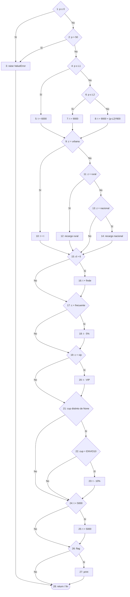

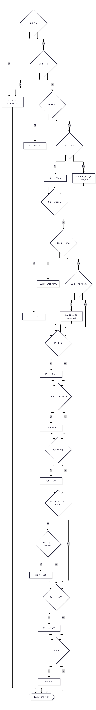

**Observación:** la arista 13 → 15 (zona que no es urbana, rural ni nacional) sigue de largo sin lanzar error. Eso es el defecto DEF-01, y se ve en el grafo.

## 4.2 Complejidad ciclomática (tres formas)

| Método          | Cálculo                           | V(G)   |
|-----------------|-----------------------------------|--------|
| Aristas y nodos | V = E − N + 2 = 41 − 28 + 2       | **15** |
| Nodos predicado | V = P + 1 = 14 + 1                | **15** |
| Regiones        | 14 regiones cerradas + 1 exterior | **15** |

- E = 41 aristas, N = 28 nodos.
- P = 14 predicados: nodos 1, 2, 4, 6, 9, 11, 13, 15, 17, 19, 21, 22, 24 y 26.

Los tres métodos coinciden: se necesitan **15 caminos independientes**. V(G) entre 11 y 20 se considera riesgo moderado.

## 4.3 Caminos independientes y casos de prueba

Camino base: P1. Cada camino siguiente cambia una decisión y agrega al menos una arista nueva. El esperado sale de la especificación.

| Camino | Nodos recorridos | Caso | Entradas (peso, zona, cliente, día, cupón) | Esperado |
|---------------|---------------|---------------|---------------|---------------|
| P1 | 1-2-4-6-7-9-10-15-17-19-21-24-26-28 | CP17 | 5, urbana, normal, 3, — | \$9.000 |
| P2 | 1-3-28 | CP01 | 0, urbana, normal, 3, — | error |
| P3 | 1-2-3-28 | CP02 | 51, urbana, normal, 3, — | error |
| P4 | …4-5-9… | CP07 | 3, urbana, normal, 3, — | \$6.000 |
| P5 | …6-8-9… | CP10 | 10,5, urbana, normal, 3, — | \$9.400 |
| P6 | …9-11-12-15… | CP12 | 5, rural, normal, 3, — | \$11.300 |
| P7 | …9-11-13-14-15… | CP13 | 5, nacional, normal, 3, — | \$12.600 |
| P8 | …9-11-13-15… | CP03 | 5, aérea, normal, 3, — | error |
| P9 | …15-16-17… | CP18 | 5, urbana, normal, 7, — | \$11.000 |
| P10 | …17-18-19… | CP21 | 5, urbana, frecuente, 3, — | \$8.600 |
| P11 | …19-20-21… | CP25 | 5, urbana, vip, 3, — | \$7.700 |
| P12 | …21-22-24… | CP15 | 5, urbana, normal, 3, PROMO99 | \$9.000 |
| P13 | …22-23-24… | CP19 | 5, urbana, normal, 3, ENVIO10 | \$8.100 |
| P14 | …24-25-26… | CP16 | 3, urbana, vip, 3, ENVIO10 | \$5.000 |
| P15 | …26-27-28 | **CP29 (nuevo)** | 5, urbana, normal, 3, —, flag=True | \$9.000 y escribe "costo:" en pantalla |

Los 28 casos de caja negra cubren 14 de los 15 caminos. Ninguno usa `flag=True`, así que agrego **CP29**, un caso de caja blanca (técnica: camino independiente).

## 4.4 Cobertura

**Cobertura de sentencias** (ejecutar los 28 nodos). Basta con 7 casos:

| Caso | Nodos que aporta  |
|------|-------------------|
| CP01 | 3                 |
| CP16 | 5, 10, 20, 23, 25 |
| CP12 | 7, 12             |
| CP10 | 8                 |
| CP13 | 14                |
| CP22 | 16, 18            |
| CP29 | 27                |

**Cobertura de ramas** (cada predicado en Sí y en No). Se agregan 3 casos a los 7 anteriores:

| Caso agregado | Rama que aporta                   |
|---------------|-----------------------------------|
| CP02          | nodo 2 en Sí (`p > 50`)           |
| CP03          | nodo 13 en No (zona inválida)     |
| CP15          | nodo 22 en No (cupón inexistente) |

Conjunto de ramas: **CP01, CP02, CP03, CP10, CP12, CP13, CP15, CP16, CP22 y CP29** (10 casos). La cobertura de ramas incluye a la de sentencias.

**Con los 29 casos se logra 100 % de sentencias y de ramas sobre el código heredado, y aun así hay defectos.** La cobertura mide qué líneas se ejecutan, no si el resultado es correcto.

# Parte 5 · Automatización, ejecución y defectos

## 5.1 Automatización de los casos con pytest

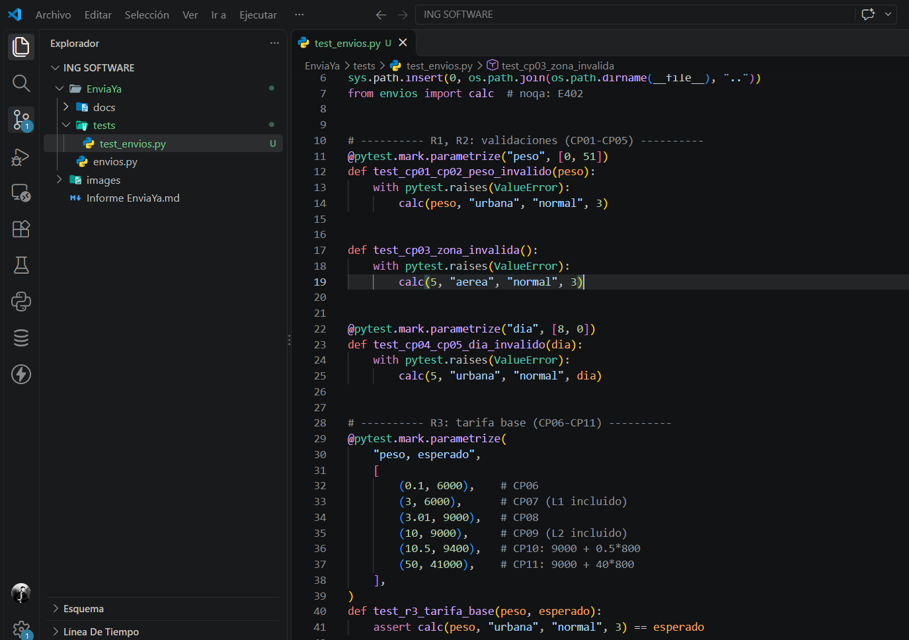

Los 28 casos de la Parte 3 y el CP29 de la Parte 4 se automatizaron en `EnviaYa/tests/test_envios.py`. Se ejecutaron contra el código heredado `v1.0.0`, sin modificarlo.

Comando: `python -m pytest -v`

**(Captura de pytest: pruebas )**

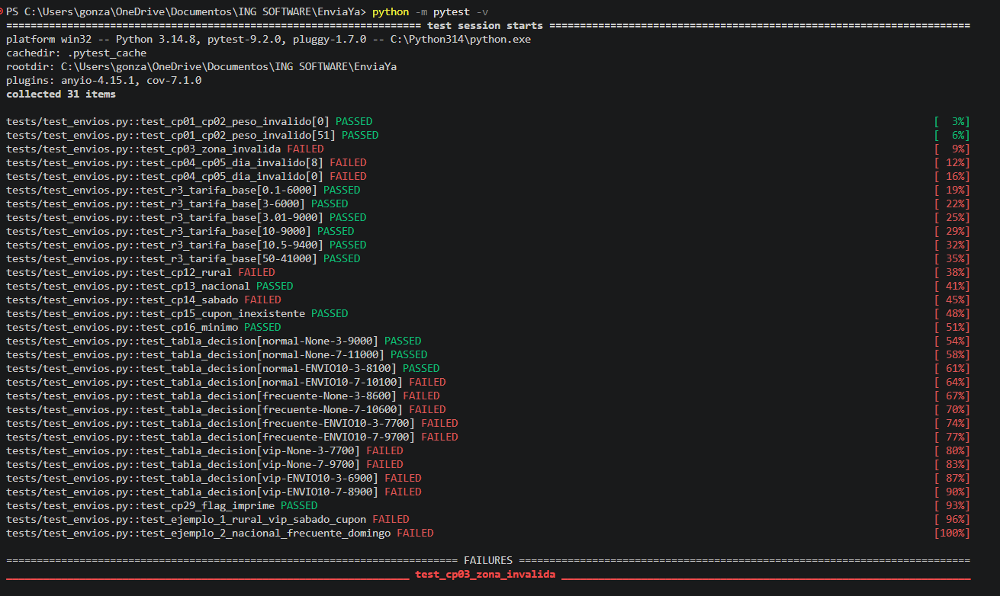

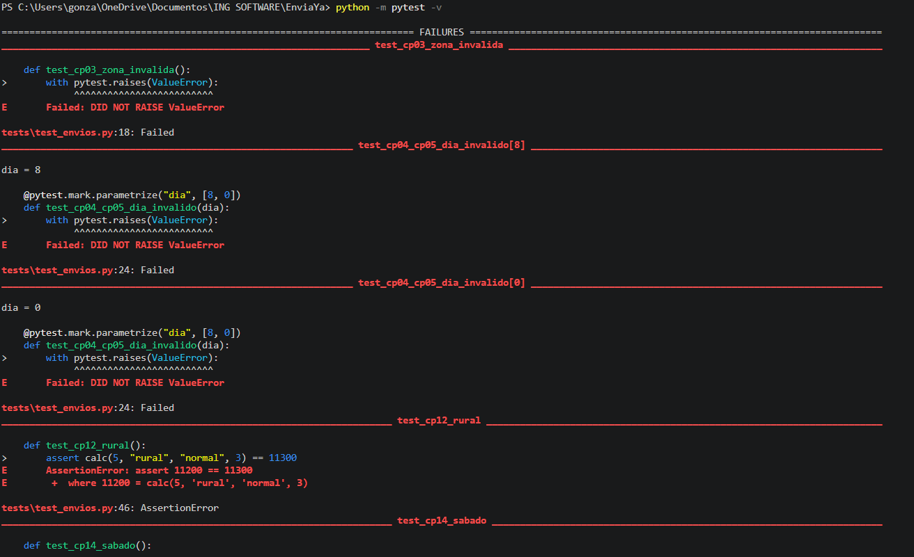

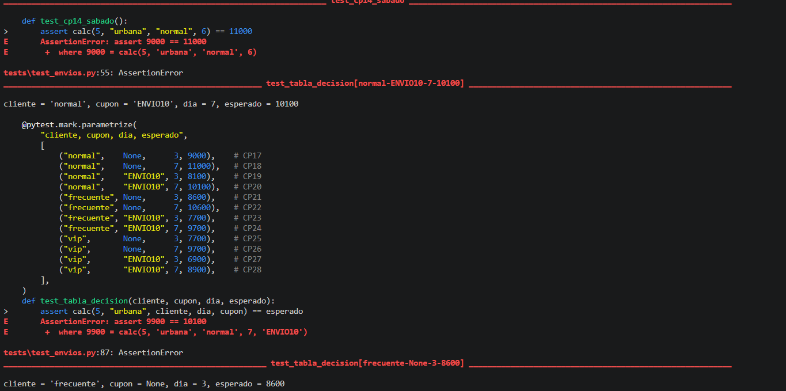

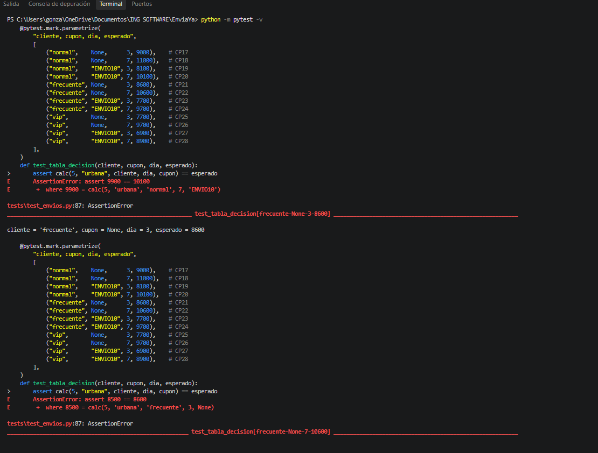

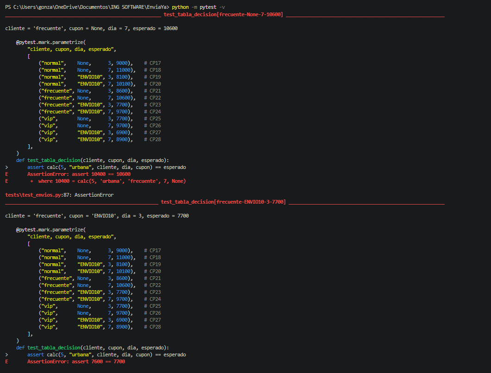

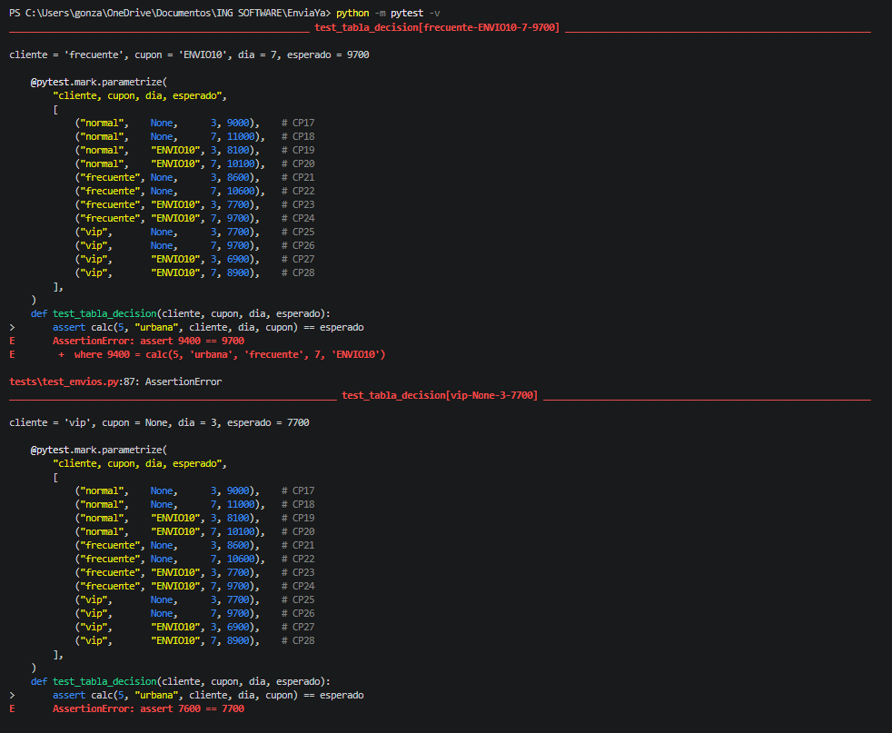

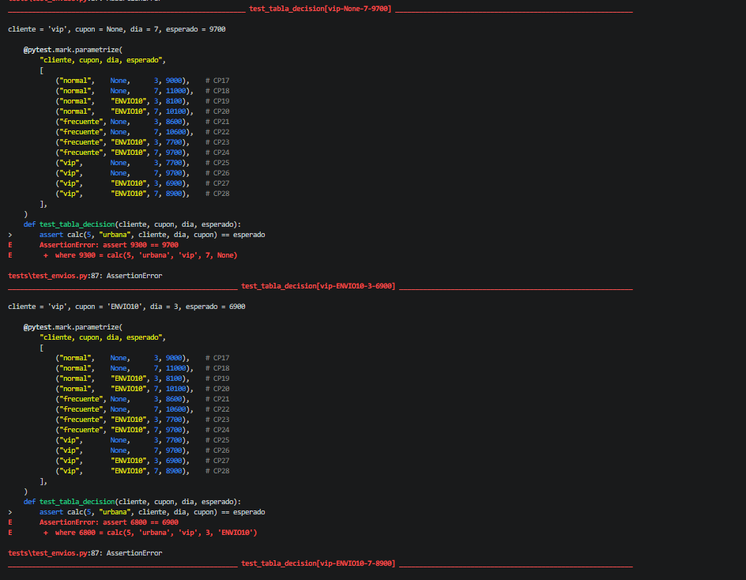

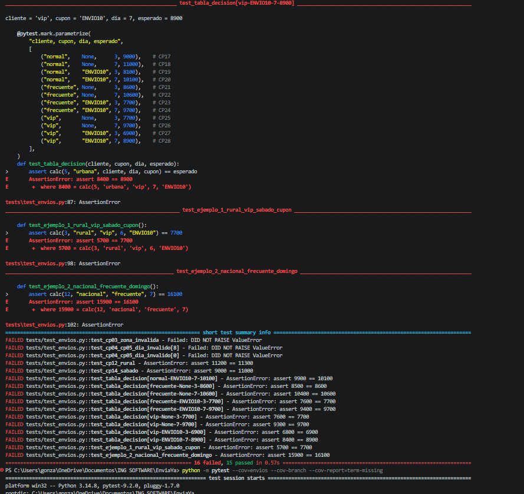

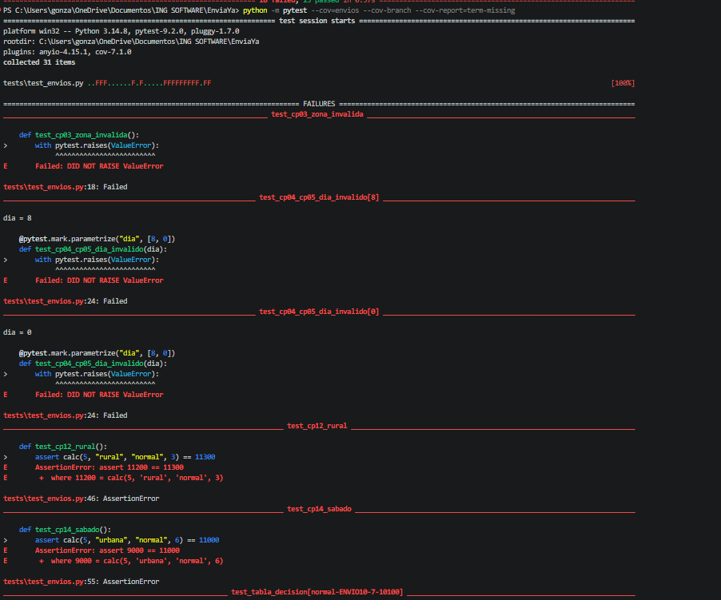

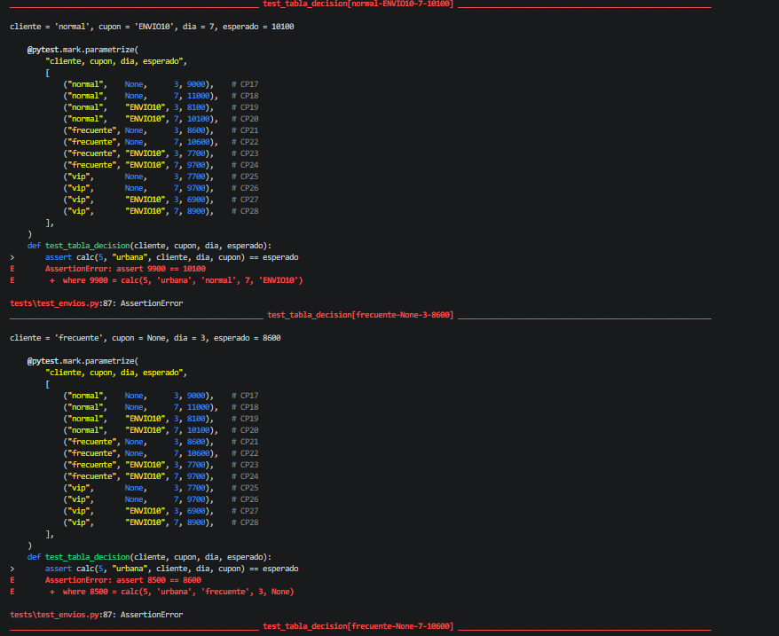

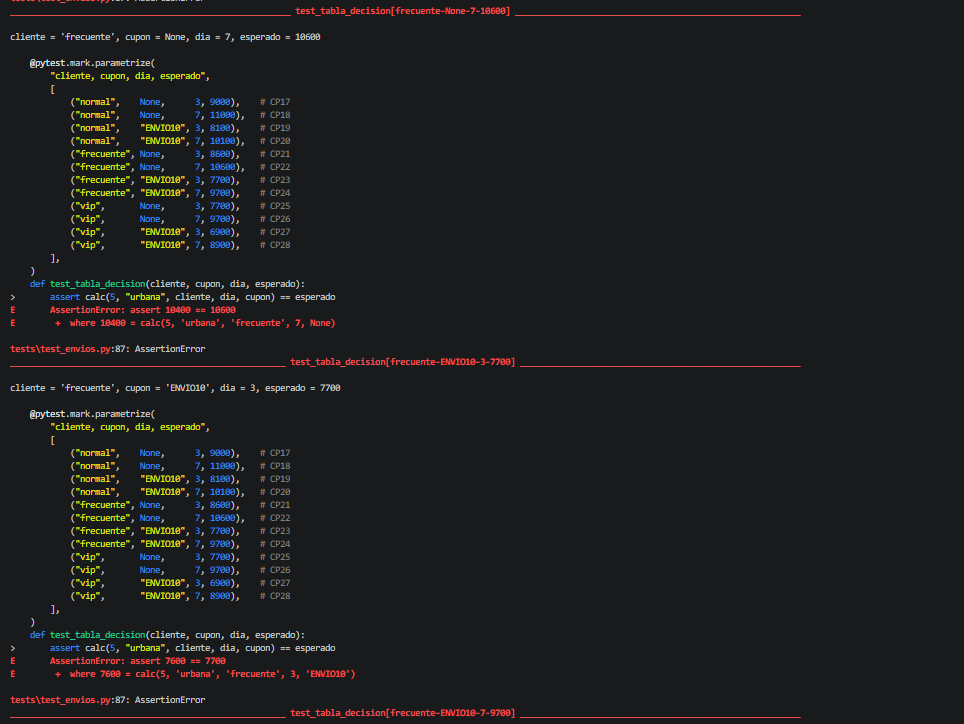

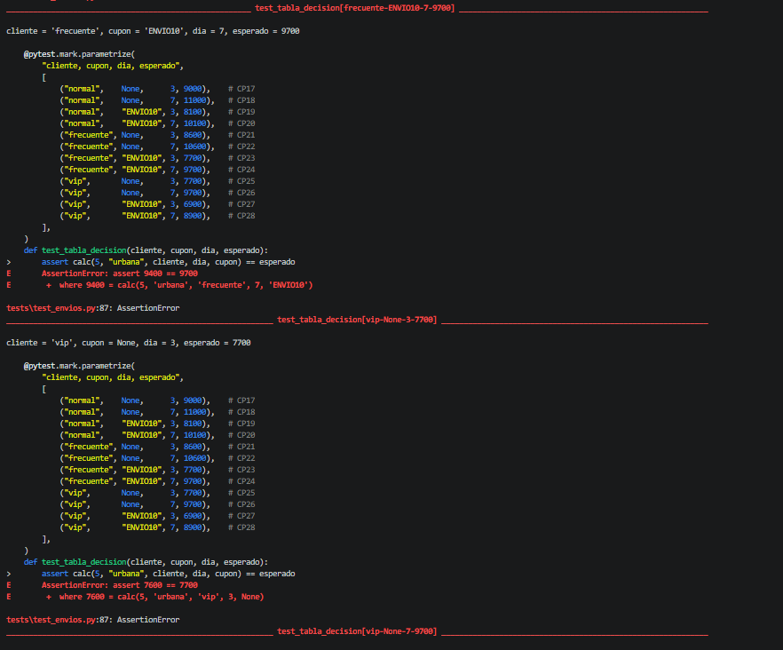

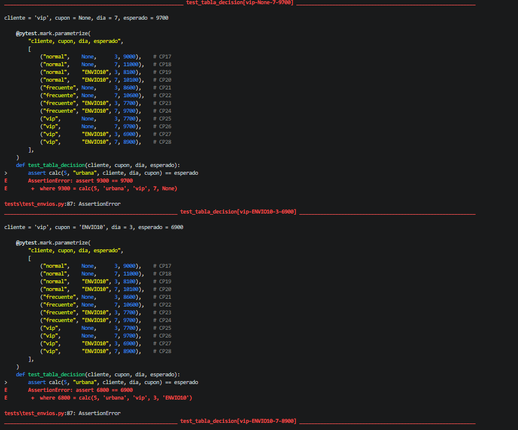

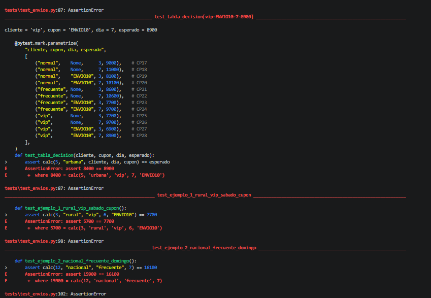

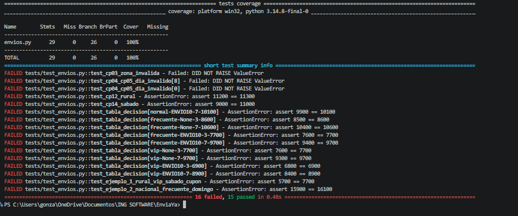

Resultado: 15 pasan, 16 fallan, de 31 pruebas.

## 5.2 Cobertura

Comando: `python -m pytest --cov=envios --cov-branch --cov-report=term-missing`

(Captura de la cobertura)

Cobertura de sentencias: 100 % (29 de 29). Cobertura de ramas: 100 % (26 de 26).

## 5.3 Registro de defectos

| ID | Título | Req. | Pasos para reproducir | Esperado | Obtenido | Severidad | Prioridad |
|---------|---------|---------|---------|---------|---------|---------|---------|
| DEF-01 | No valida la zona | R2 | `calc(5, "aerea", "normal", 3)` | Error | 9000 | Media | Media |
| DEF-02 | No valida el día entre 1 y 7 | R2 | `calc(5, "urbana", "normal", 8)` | Error | 11000 | Media | Media |
| DEF-03 | El sábado no cobra recargo (`d > 6`) | R5 | `calc(5, "urbana", "normal", 6)` | 11000 | 9000 | Alta | Alta |
| DEF-04 | Recargo de fin de semana antes de los descuentos | R5 | `calc(5, "urbana", "frecuente", 7)` | 10600 | 10400 | Alta | Alta |
| DEF-05 | Trunca en vez de redondear | R8 | `calc(5, "rural", "normal", 3)` | 11300 | 11200 | Alta | Alta |

**Justificación:** - **DEF-03, 04 y 05:** cobran mal a clientes reales (severidad alta) y afectan muchos envíos, así que se corrigen primero. - **DEF-01 y 02:** aceptan datos inválidos y devuelven un precio sin avisar, pero no son comunes con datos bien capturados (severidad media).

## 5.4 Métricas 

| Métrica | Fórmula | Valor |
|----|----|----|
| \% de casos que pasan | pasan / total × 100 | 15 / 31 × 100 = **48,4 %** |
| Defectos por severidad | Alta: 3, Media: 2, Baja: 0 | 5 en total |
| Densidad de defectos | defectos / líneas × 100 | 5 / 40 × 100 = **12,5 por cada 100 líneas** (ver nota) |
| Cobertura de sentencias | de pytest-cov | **100 %** (29 de 29) |
| Cobertura de ramas | de pytest-cov | **100 %** (26 de 26) |

|     |
|-----|
|     |

## Resultados contra el heredado: 16 fallan, 15 pasan (31 pruebas)

Los fallos son los esperados y coinciden con los 5 defectos. Cobertura: **100 % de sentencias (29/29) y 100 % de ramas (26/26)**.

### Corrección importante a mi tabla de defectos

Con lo que salió, mi tabla de “Obtenido” tenía **dos valores mal**. Usa estos, que son los reales de tu ejecución:

| ID | Título | Req. | Pasos para reproducir | Esperado | Obtenido | Severidad | Prioridad |
|----|----|----|----|----|----|----|----|
| DEF-01 | No valida la zona | R2 | `calc(5, "aerea", "normal", 3)` | Error | 9000 (sin error) | Media | Media |
| DEF-02 | No valida el día (1 a 7) | R2 | `calc(5, "urbana", "normal", 8)` | Error | 9000 (sin error) | Media | Media |
| DEF-03 | El sábado no cobra recargo (`d > 6`) | R5 | `calc(5, "urbana", "normal", 6)` | 11000 | 9000 | Alta | Alta |
| DEF-04 | Recargo de fin de semana antes de los descuentos | R5 | `calc(5, "urbana", "normal", 7, "ENVIO10")` | 10100 | 9900 | Alta | Alta |
| DEF-05 | Trunca en vez de redondear | R8 | `calc(5, "rural", "normal", 3)` | 11300 | 11200 | Alta | Alta |

Mis errores anteriores: DEF-02 dije 11000 (es 9000, porque el día 8 no suma recargo) y DEF-04 usé un caso (frecuente, día 7) que mezcla DEF-04 con DEF-05. El de arriba aísla DEF-04: sin redondeo de por medio, 9.000 × 0,90 = 8.100 y luego +2.000 = 10.100, mientras el heredado suma antes: 11.000 × 0,90 = 9.900.

### Métricas (Parte 5.4)

| Métrica | Valor |
|----|----|
| Pruebas ejecutadas | 31 (28 casos + CP29 + 2 ejemplos; los parametrizados cuentan por separado) |
| Pasan / fallan | 15 / 16 |
| \% que pasan | 15/31 = **48,4 %** |
| Defectos por severidad | Alta: 3, Media: 2, Baja: 0 (total 5) |
| Densidad de defectos | 5 / 40 líneas × 100 = **12,5 por cada 100 líneas** (usa 40 si `envios.py` tiene 40 líneas; compruébalo con `(Get-Content EnviaYa\envios.py).Count`) |
| Cobertura de sentencias | **100 %** (29 de 29) |
| Cobertura de ramas | **100 %** (26 de 26) |

Nota para el informe: coverage.py cuenta `p <= 0 or p > 50` como una sola decisión, por eso mide 26 ramas y no las 28 aristas de mi grafo. Y la lección: **100 % de cobertura y aun así 16 fallos**; la cobertura mide qué se ejecuta, no si el resultado es correcto.

# Parte 6 · Mantenimiento y refactorización

## 6.1 Malos olores (code smells)

### Metodología

Se revisó `calc` (líneas 11-40) de dos formas:

1.  **Herramientas:** `pylint` (nota 6,90/10) y `radon` (complejidad ciclomática 15, rango C).

2.  **Revisión manual** con una lista de verificación. Pylint no detecta Magic Number, Cryptic Naming, Duplicate Code ni Primitive Obsession.

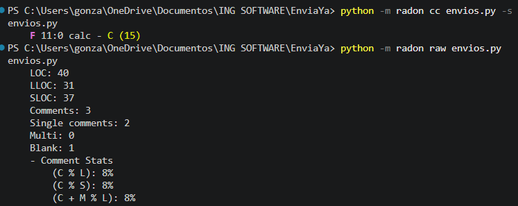

**Criterio smell vs. defecto:** un *defecto* cambia el resultado y viola un requisito (DEF-01 a DEF-05). Un *mal olor* no cambia el resultado, pero hace el código difícil de leer, probar y modificar.

### Tabla de malos olores

| \# | Mal olor | Líneas | Evidencia | Deuda técnica |
|----|----|----|----|----|
| 1 | **Magic Number** | 12 (`50`), 15 (`6000`), 17 y 19 (`9000`), 19 (`800`), 27 (`6`), 30 (`0.05`), 35 (`0.10`), 37 (`5000`), 40 (`100`) | Manual | Para cambiar una tarifa hay que buscar números sin significado. La configuración es inconsistente: `L1` y `L2` están en `CONFIG`, pero `50`, `6000` y `5000` no. |
| 2 | **Flag Argument** | 11 (`flag=False`) y 38-39 | Manual | `calc` calcula o calcula e imprime según un booleano. Son dos comportamientos en una función y el `print` es un efecto secundario dentro de un cálculo. |
| 3 | **Long Method** | 11-40 | Pylint R0912: 14 ramas (límite 12). Radon: complejidad 15 | Una sola función valida, tarifa, recarga, descuenta, aplica mínimo, imprime y redondea. Tiene demasiados caminos y es difícil de probar y de entender. |
| 4 | **Switch Statements** (cadenas `if/elif`) | 20-25 (zona) y 29-35 (cliente y cupón) | Pylint R0912 | Agregar una zona, cliente o cupón obliga a modificar `calc`. Viola el principio Open/Closed. |
| 5 | **Cryptic Naming** | 11 (`p, z, c, d, cup`) y `t` en todo el cuerpo | Manual | Hay que adivinar qué significa cada variable. `t` cambia de sentido: tarifa base, tarifa con recargo y total con descuento. |
| 6 | **Dead Code** (autoasignación) | 21 (`t = t`) | Pylint W0127 | No hace nada. Solo añade ruido y confunde al lector. |
| 7 | **Duplicate Code** | 23, 25, 30, 32, 35 | Manual | La fórmula `t = t ± t * X` se repite 5 veces. Si cambia el modo de calcular, hay que tocar cada línea. |
| 8 | **Primitive Obsession** | 20, 22, 24, 29, 31, 34 (`"urbana"`, `"rural"`, `"vip"`, `"ENVIO10"`) | Manual | Zona, cliente y cupón son strings sueltos, sin tipo ni validación. Un error de tipeo pasa en silencio, como en DEF-01. |
| 9 | **Long Parameter List** | 11 | Pylint R0913 y R0917: 6 argumentos (límite 5) | Muchos parámetros posicionales hacen fácil pasarlos en orden equivocado. Uno de ellos es el flag. |
| 10 | **Nested Conditional** y comparación no idiomática | 33-35 (`if cup != None:` con un `if` dentro) | Pylint C0121 | Anidamiento innecesario. `!= None` debe escribirse `is not None`. Se puede aplanar en una sola condición. |

### Avisos de pylint sin smell propio

| Aviso | Línea | Comentario |
|----|----|----|
| R1731 `consider-using-max-builtin` | 36 | El mínimo de \$5.000 se resuelve con `max(t, MINIMO)`. Se aplica en el refactor. |
| C0114 y C0116 | 1 y 11 | Falta documentación del módulo y de la función. |
| C0304 | 40 | Falta el salto de línea final (formato). |

### Métricas “antes” (v1.0.0)

| Métrica                                   | Valor                           |
|-------------------------------------------|---------------------------------|
| Complejidad ciclomática de `calc` (radon) | **15** (rango C)                |
| LOC / SLOC / LLOC                         | 40 / 37 / 31                    |
| Ramas (pylint)                            | 14/12                           |
| Nota pylint                               | 6,90/10                         |
| Cobertura (pytest-cov)                    | 100 % (29 sentencias, 26 ramas) |
| Pruebas que pasan                         | 15/31                           |

**Cálculo manual de la complejidad (nodos predicado + 1):** hay 14 predicados. Las líneas 12 (2, por el `or`), 14, 16, 20, 22, 24, 27, 29, 31, 33, 34, 36 y 38 aportan 1 cada una. Resultado: 14 + 1 = **15**, igual que radon.

### Qué NO es un mal olor (para la sustentación)

- **La falta de `else` en las líneas 20-25 y de validación del día** son los defectos DEF-01 y DEF-02, porque incumplen R2.

- **`d > 6` (línea 27)** es DEF-03, no un smell.

- **El `50` de la línea 12** coincide con tu PMAX, así que no cambia el resultado. Por eso es Magic Number y no defecto.

### Defectos y su ubicación (referencia cruzada)

| Defecto | Línea(s)                                            |
|---------|-----------------------------------------------------|
| DEF-01  | 20-25 (falta el `else`)                             |
| DEF-02  | falta validar `d` antes de la línea 27              |
| DEF-03  | 27 (`d > 6` debe ser `d >= 6`)                      |
| DEF-04  | 27-28 (el recargo va antes de los descuentos 29-35) |
| DEF-05  | 40 (`int(t / 100) * 100` trunca)                    |

## 6.2 Clasificación de los cambios

### Criterio de clasificación

| Tipo | Se hace cuando... | Cambia el resultado |
|----|----|----|
| **Correctivo** | Hay un defecto que incumple un requisito | Sí (lo corrige) |
| **Adaptativo** | Cambia el entorno o una regla de negocio | Sí (nueva regla) |
| **Perfectivo** | Se mejora legibilidad, estructura o rendimiento | No |
| **Preventivo** | Se reduce el riesgo de fallos o se facilita el cambio futuro | No |

### Tabla de cambios

| \# | Cambio | Rama | Líneas (v1.0.0) | Tipo | Justificación |
|----|----|----|----|----|----|
| 1 | DEF-01: lanzar `ValueError` si la zona es inválida | `fix/DEF-01` | 20-25 | Correctivo | Incumple R2: acepta zonas desconocidas sin recargo ni error. |
| 2 | DEF-02: validar que el día esté entre 1 y 7 | `fix/DEF-02` | antes de 27 | Correctivo | Incumple R2: acepta días inválidos. |
| 3 | DEF-03: `d > 6` pasa a `d >= 6` | `fix/DEF-03` | 27 | Correctivo | El sábado no cobraba recargo, contra R5. |
| 4 | DEF-04: recargo de fin de semana después de los descuentos | `fix/DEF-04` | 27-35 | Correctivo | Con tu E = 7 (impar) debe ir después. El mínimo de \$5.000 se aplica tras sumarlo. |
| 5 | DEF-05: redondear al múltiplo de 100 más cercano (50 hacia arriba) | `fix/DEF-05` | 40 | Correctivo | `int(t/100)*100` trunca, contra R8. |
| 6 | Constantes con nombre para los números mágicos | `refactor/estrategia` | 12, 15, 17, 19, 27, 30, 35, 37, 40 | Perfectivo | Mejora la legibilidad y centraliza la configuración. |
| 7 | Nombres descriptivos y eliminar `t = t` | `refactor/estrategia` | 11-40 y 21 | Perfectivo | Mejora la legibilidad; el resultado no cambia. |
| 8 | Extraer funciones (validar, tarifa base, redondeo) y aplanar el condicional del cupón | `refactor/estrategia` | 11-40 y 33-35 | Perfectivo | Reduce el Long Method y la complejidad por función. |
| 9 | Eliminar el argumento `flag` y su `print` | `refactor/estrategia` | 11 y 38-39 | Perfectivo | Separa calcular de imprimir y baja a 5 los parámetros. |
| 10 | Patrón Estrategia para zonas y descuentos | `refactor/estrategia` | 20-35 | Preventivo | No arregla nada hoy. Evita modificar `calc` al agregar zonas, clientes o cupones. |
| 11 | Cliente empresarial 12 % y sin recargo de zona si peso \> 10 | `feature/cliente-empresarial` | nueva | Adaptativo | Nueva regla de negocio (Parte 8). |

**Resumen:** 5 correctivos, 4 perfectivos, 1 preventivo y 1 adaptativo.

### Relación entre malos olores (6.1) y cambios (6.2)

| Mal olor                | Cambio que lo resuelve                          |
|-------------------------|-------------------------------------------------|
| 1\. Magic Number        | #6                                              |
| 2\. Flag Argument       | #9                                              |
| 3\. Long Method         | #8                                              |
| 4\. Switch Statements   | #10                                             |
| 5\. Cryptic Naming      | #7                                              |
| 6\. Dead Code           | #7                                              |
| 7\. Duplicate Code      | #10 (cada estrategia aplica su porcentaje) y #8 |
| 8\. Primitive Obsession | #10                                             |
| 9\. Long Parameter List | #9                                              |
| 10\. Nested Conditional | #8                                              |

### Orden de ejecución y por qué

1.  Primero los correctivos (#1 a #5), uno por rama. Cada uno debe convertirse en verde algunas de mis pruebas fallidas, y eso es la evidencia.

2.  Luego los perfectivos y preventivos (#6 a #10) en `refactor/estrategia`. Aquí la regresión no debe cambiar ningún resultado: si una prueba cambia, el cambio ya no es un refactor.

3.  Al final el adaptativo (#11), con las pruebas escritas primero.

## 6.3 Refactorización

### Paso 1: los 5 fixes (uno por rama)

**FIX 1: DEF-01 (zona inválida)**

``` sql
git checkout -b fix/DEF-01
```

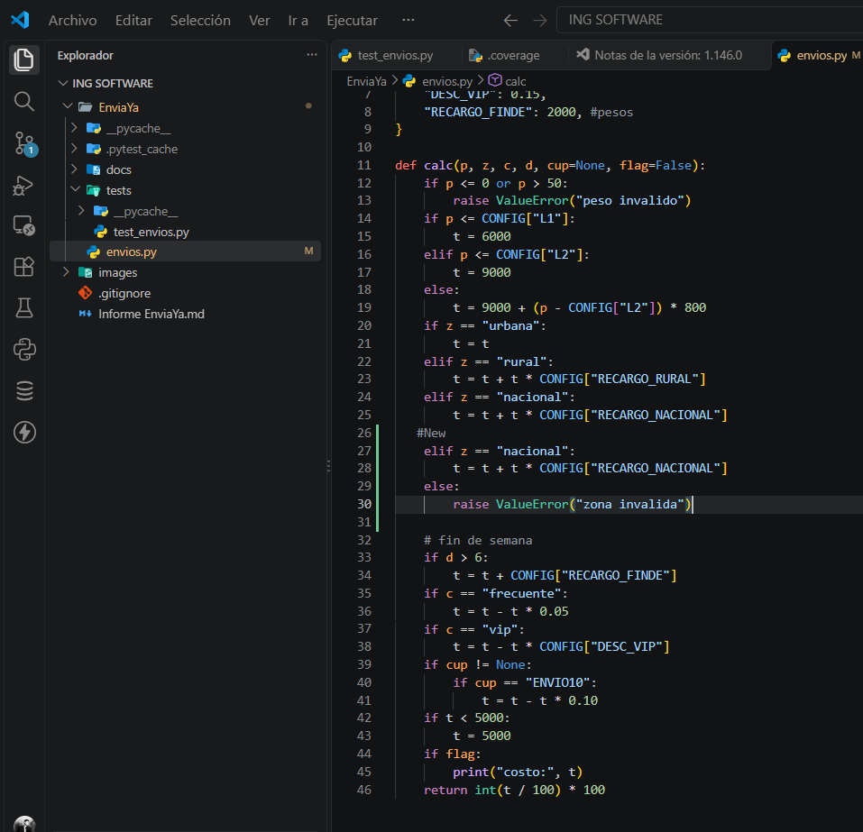

``` sql
git checkout -b fix/DEF-02
```

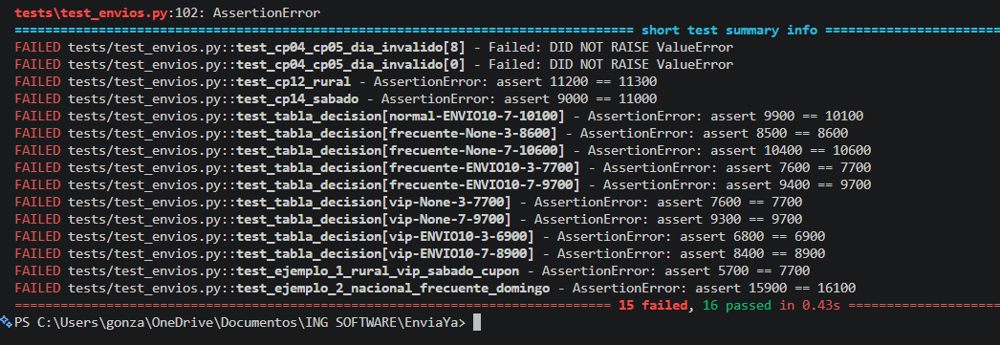

**FIX 2: DEF-02 (día fuera de 1 a 7)**

``` sql
git checkout -b fix/DEF-02
```

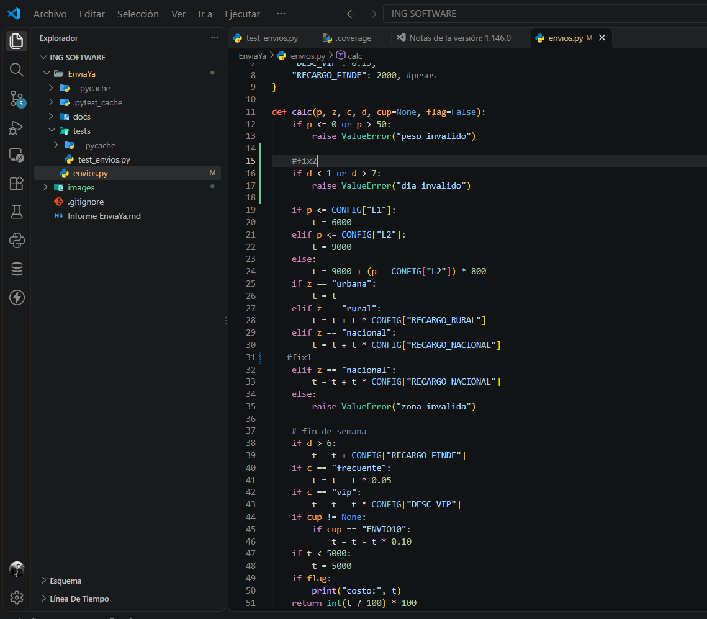

``` sql
python -m pytest
```

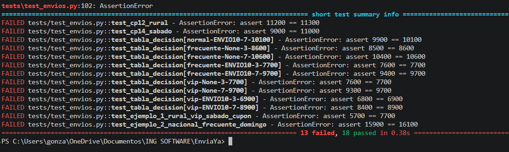

**FIX 3: DEF-03 (el sábado debe cobrar)**

``` sql
git checkout -b fix/DEF-03
```

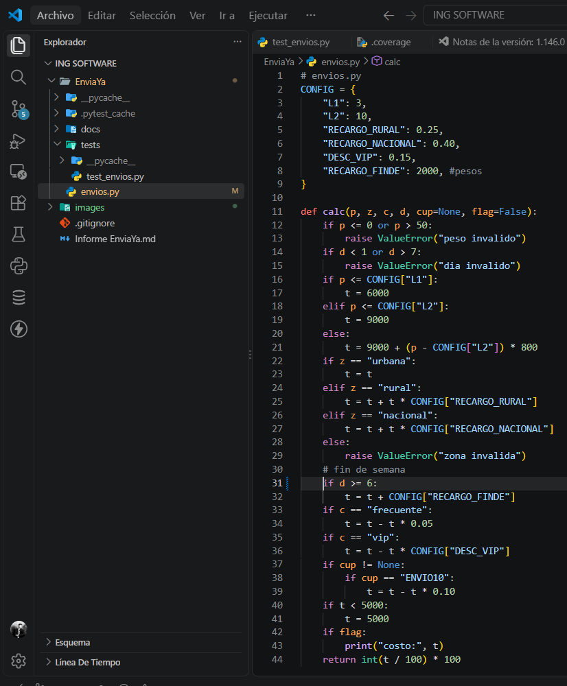

``` sql
python -m pytest
```

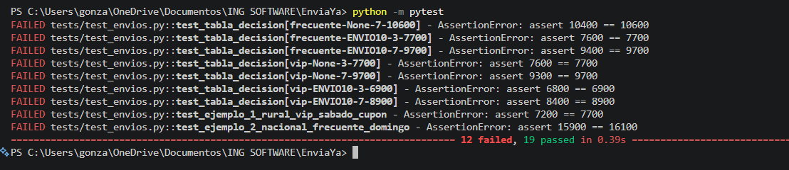

**FIX 4: DEF-04 (el recargo va después de los descuentos)**

``` sql
git checkout -b fix/DEF-04
```

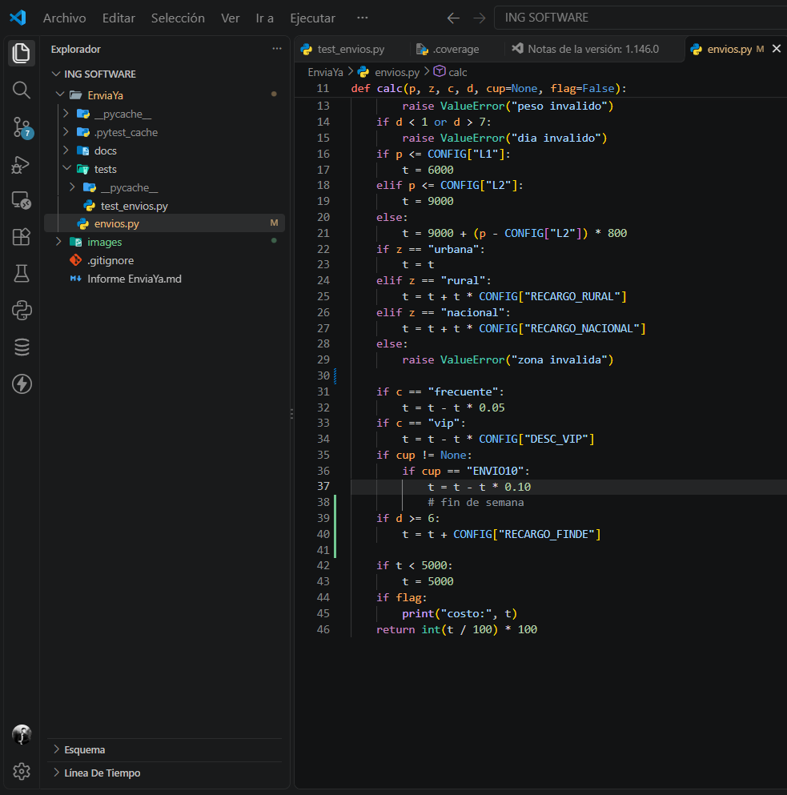

``` sql
python -m pytest
```

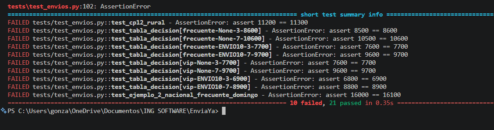

**FIX 5: DEF-05 (redondeo)**

``` sql
git checkout -b fix/DEF-05
```

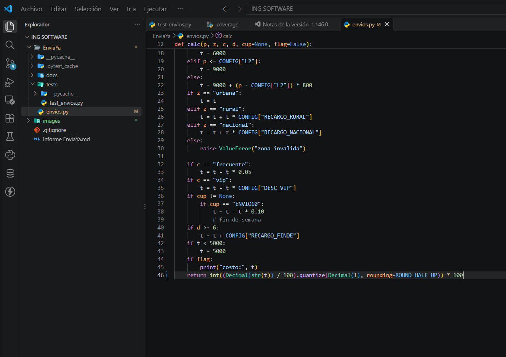

``` sql
python -m pytest
```

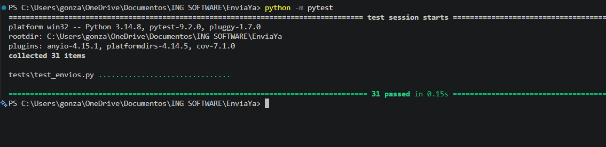

**Commit A: constantes, nombres, funciones extraídas y sin `flag`**

Reemplazamos todo `EnviaYa\envios.py` por esto:

``` python
"""Calculo del costo de envio de EnviaYa."""
from decimal import Decimal, ROUND_HALF_UP

CONFIG = {
    "L1": 3,
    "L2": 10,
    "RECARGO_RURAL": 0.25,
    "RECARGO_NACIONAL": 0.40,
    "DESC_VIP": 0.15,
    "RECARGO_FINDE": 2000,  # pesos
}

PESO_MAX = 50
TARIFA_TRAMO_1 = 6000
TARIFA_TRAMO_2 = 9000
TARIFA_KG_EXTRA = 800
DESC_FRECUENTE = 0.05
DESC_CUPON_ENVIO10 = 0.10
COSTO_MINIMO = 5000
MULTIPLO_REDONDEO = 100
DIA_MIN = 1
DIA_SABADO = 6
DIA_MAX = 7


def _validar(peso, zona, dia):
    if peso <= 0 or peso > PESO_MAX:
        raise ValueError("peso invalido")
    if dia < DIA_MIN or dia > DIA_MAX:
        raise ValueError("dia invalido")
    if zona not in ("urbana", "rural", "nacional"):
        raise ValueError("zona invalida")


def _tarifa_base(peso):
    if peso <= CONFIG["L1"]:
        return TARIFA_TRAMO_1
    if peso <= CONFIG["L2"]:
        return TARIFA_TRAMO_2
    return TARIFA_TRAMO_2 + (peso - CONFIG["L2"]) * TARIFA_KG_EXTRA


def _redondear(valor):
    """Redondea al multiplo de 100 mas cercano; los 50 suben."""
    cociente = Decimal(str(valor)) / MULTIPLO_REDONDEO
    return int(cociente.quantize(Decimal(1), rounding=ROUND_HALF_UP)) * MULTIPLO_REDONDEO


def calc(peso, zona, cliente, dia, cupon=None):
    """Costo del envio en pesos."""
    _validar(peso, zona, dia)
    total = _tarifa_base(peso)
    if zona == "rural":
        total = total * (1 + CONFIG["RECARGO_RURAL"])
    elif zona == "nacional":
        total = total * (1 + CONFIG["RECARGO_NACIONAL"])
    if cliente == "frecuente":
        total = total * (1 - DESC_FRECUENTE)
    elif cliente == "vip":
        total = total * (1 - CONFIG["DESC_VIP"])
    if cupon == "ENVIO10":
        total = total * (1 - DESC_CUPON_ENVIO10)
    if dia >= DIA_SABADO:  # despues de descuentos (E impar)
        total = total + CONFIG["RECARGO_FINDE"]
    total = max(total, COSTO_MINIMO)
    return _redondear(total)
```

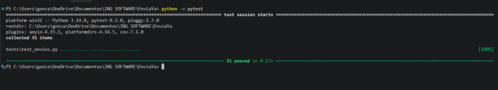

**Diagrama UML de el modelo envios.py**

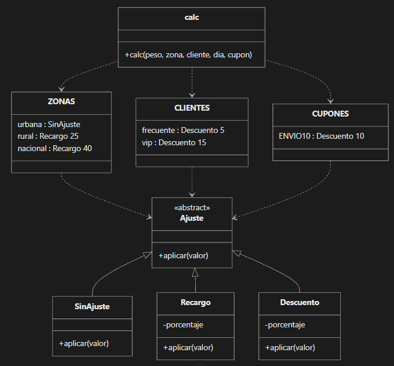

## 6.4 Corrección de defectos

Los datos salen de tus commits y de las salidas de pytest que me pegaste.

### Tabla de correcciones

| Defecto | Requisito | Línea original (v1.0.0) | Corrección | Rama | Commit |
|----|----|----|----|----|----|
| DEF-01 | R2 | 20-25 (sin `else`) | `else: raise ValueError("zona invalida")` | `fix/DEF-01` | `79bdde9` |
| DEF-02 | R2 | Sin validación de `d` | `if d < 1 or d > 7: raise ValueError("dia invalido")` | `fix/DEF-02` | `813fe6b` |
| DEF-03 | R5 | 27 (`d > 6`) | `d >= 6`, para que el sábado cobre | `fix/DEF-03` | `70177c8` |
| DEF-04 | R5 / regla E (impar) | 27-28 (recargo antes de los descuentos) | El recargo se mueve después del cupón y antes del mínimo | `fix/DEF-04` | `9e36a2c` |
| DEF-05 | R8 | 40 (`int(t/100)*100` trunca) | `Decimal` con `ROUND_HALF_UP`, al múltiplo de 100 más cercano | `fix/DEF-05` | `33ebc92` |

Cada rama se integró a `main` con `git merge --no-ff`. El conjunto quedó etiquetado como **v1.0.1**.

### Commits de limpieza

Dos commits no corrigen ningún defecto, y los clasifico como perfectivos:

| Commit | Qué hizo |
|----|----|
| `8c35391` (`fix/limpieza-zonas`) | Quitó el `elif "nacional"` duplicado y los comentarios de depuración que dejaron los fixes 1 y 2. |
| `b318193` (`fix/limpieza-def04`) | Quitó una línea en blanco sobrante tras el DEF-04. |

### Qué pruebas puso en verde cada defecto

Las 16 pruebas que fallaban en v1.0.0 se explican así. Calculé a mano cada caso, y los resultados del heredado coinciden con los de tu pytest.

| Prueba (fallaba en v1.0.0) | Valor heredado | Esperado | Defecto(s) |
|----|----|----|----|
| `test_cp03_zona_invalida` | no lanza error | `ValueError` | DEF-01 |
| `test_cp04_cp05_dia_invalido[8]` y `[0]` | no lanza error | `ValueError` | DEF-02 |
| `test_cp14_sabado` | 9000 | 11000 | DEF-03 |
| `test_tabla_decision[normal-ENVIO10-7]` | 9900 | 10100 | DEF-04 |
| `test_tabla_decision[frecuente-None-3]`, `[frecuente-ENVIO10-3]`, `[vip-None-3]`, `[vip-ENVIO10-3]` | 8500, 7600, 7600, 6800 | 8600, 7700, 7700, 6900 | DEF-05 |
| `test_cp12_rural` | 11200 | 11300 | DEF-05 |
| `test_tabla_decision[frecuente-None-7]`, `[frecuente-ENVIO10-7]`, `[vip-None-7]`, `[vip-ENVIO10-7]` | 10400, 9400, 9300, 8400 | 10600, 9700, 9700, 8900 | DEF-04 y DEF-05 |
| `test_ejemplo_2_nacional_frecuente_domingo` | 15900 | 16100 | DEF-04 y DEF-05 |
| `test_ejemplo_1_rural_vip_sabado_cupon` | 5700 | 7700 | DEF-03, DEF-04 y DEF-05 |

Un ejemplo de DEF-05: `calc(5, "rural", "normal", 3)` da 9000 × 1,25 = 11.250. El código heredado trunca a 11.200 y lo correcto es 11.300, porque el \$50 sube.

Por eso varias pruebas solo pasan cuando están los tres defectos corregidos, y la suite completa quedó verde al terminar el DEF-05.

## 6.5 Pruebas de regresión

| Momento                 | Commit / versión   | Resultado            |
|-------------------------|--------------------|----------------------|
| Código heredado + suite | `a6c8716` (v1.0.0) | 16 failed, 15 passed |
| DEF-01                  | `79bdde9`          | 15 failed, 16 passed |
| DEF-02                  | `813fe6b`          | 13 failed, 18 passed |
| DEF-03                  | `70177c8`          | 12 failed, 19 passed |
| DEF-04                  | `9e36a2c`          | 10 failed, 21 passed |
| DEF-05                  | `33ebc92` (v1.0.1) | 31 passed            |
| Refactor Estrategia     | `27cf4d2` (v1.1.0) | 31 passed            |

### Hallazgo de la regresión

Al refactorizar, `test_cp29_flag_imprime` falló con `TypeError: calc() takes from 4 to 5 positional arguments but 6 were given`. La prueba llamaba a `calc` con `flag=True`, y ese argumento se eliminó a propósito (code smell Flag Argument). No fue un error del cálculo: cambió la interfaz.

La prueba se reemplazó por `test_cp29_calc_no_imprime`, que verifica que `calc` devuelve 9000 y no imprime nada. Con eso la suite volvió a **31 passed**, sin cambiar ningún resultado esperado. El cambio quedó en su propio commit (`cb42d1b`).

### Conclusión

Los 5 defectos están corregidos, ya que las 16 pruebas que fallaban en v1.0.0 pasan. El refactor no introdujo regresiones: las 30 pruebas de cálculo siguen verdes, y la única modificada se debe al cambio de firma de `calc`.

## 6.6 Comparación antes/después

Ya tienes los datos reales. Esta es la tabla completa para pegar en el informe.

### Tabla comparativa

| Métrica                           | Antes (v1.0.0) | Después (v1.1.0)  | Cambio |
|-----------------------------------|----------------|-------------------|--------|
| Pruebas que pasan                 | 15/31          | 31/31             | +16    |
| Complejidad ciclomática de `calc` | 15 (C)         | 2 (A)             | −13    |
| Complejidad máxima de una función | 15 (`calc`)    | 6 (`_validar`, B) | −9     |
| LOC                               | 40             | 115               | +75    |
| SLOC                              | 37             | 76                | +39    |
| LLOC                              | 31             | 74                | +43    |
| Sentencias (pytest-cov)           | 29             | 60                | +31    |
| Ramas (pytest-cov)                | 26             | 12                | −14    |
| Cobertura                         | 100 %          | 100 %             | =      |
| Nota pylint                       | 6,90/10        | 9,15/10           | +2,25  |
| Avisos pylint                     | 9              | 5                 | −4     |
| Funciones/métodos                 | 1              | 14                | +13    |

El refactor aumentó el tamaño del código (de 40 a 115 líneas) porque el patrón Estrategia introduce clases (`Ajuste`, `SinAjuste`, `Recargo`, `Descuento`), constantes con nombre y funciones auxiliares. Ese aumento no es deuda técnica: es estructura que se paga una sola vez.

Lo que mejoró es lo que más pesa en mantenimiento. La complejidad ciclomática de `calc` bajó de 15 a 2, porque los `if/elif` por zona, cliente y cupón pasaron a diccionarios de estrategias. Ninguna función supera hoy 6 (`_validar`), frente a los 15 de antes. Las ramas medidas por cobertura bajaron de 26 a 12. La cobertura se mantuvo en 100 % y las pruebas pasaron de 15/31 a 31/31, es decir, los cinco defectos quedaron corregidos y el refactor no introdujo regresiones.

En la parte cualitativa, desaparecieron los code smells Magic Number, Flag Argument, Long Method, Switch Statements, Cryptic Naming, Dead Code, Duplicate Code y Nested Conditional. La nota de pylint subió de 6,90 a 9,15.

Un beneficio concreto: agregar el cliente empresarial de la Parte 8 será una línea en `CLIENTES`, sin modificar `calc`.

# **Parte 7 · Gestión de configuración**

## 7.1 Etiqueta v1.0.0 en el código heredado

El código heredado `envios.py`, con mi CONFIG (L1 = 3, L2 = 10, rural 25 %, nacional 40 %, VIP 15 %, fin de semana \$2.000) y sin ninguna otra modificación, quedó guardado en el commit `a0c3059` y etiquetado como `v1.0.0`.

Comando usado:

```         
git tag v1.0.0 a0c3059
```

Verificación con `git show v1.0.0 --stat`:

```         
commit a0c3059742252bd9d0c8729b633421e720e481df (tag: v1.0.0)
Author: Jaime Rafael Gonzalez Ballesta
Date:   Wed Nov 11 16:49:04 2026 -0500

    Encabezado del informe con parametros EnviaYa

 EnviaYa/envios.py  | 40 ++++++++++++++++++++++++++++++++++++++++
 Informe EnviaYa.md | 68 ++++++++++++++++++++++++++++++++++++++++++++++++++++++
 README.md          |  1 -
 3 files changed, 108 insertions(+), 1 deletion(-)
```

La etiqueta también está publicada en GitHub (`git push origin v1.0.0`).

Esta versión es la línea base del proyecto: contra ella se ejecutaron las 31 pruebas de la suite, con 15 que pasan y 16 que fallan, y con ella se compara el antes y el después de las correcciones y la refactorización.

## 7.2 Ramas e integración

Se creó una rama por cada defecto, una para la refactorización y otra para la suite de pruebas. Todas se integraron a `main` con `git merge --no-ff`, para que cada rama quede visible en el grafo. Después de cada integración se ejecutó pytest.

| Rama | Propósito | Commits de la rama | Merge a `main` |
|------------------|------------------|------------------|------------------|
| `test/suite` | Suite pytest de 31 pruebas y `.gitignore` | `cfdb320`, `be4ddf2` | `a6c8716` |
| `fix/DEF-01` | Zona inválida lanza `ValueError` (R2) | `79bdde9` | `1841cb8` |
| `fix/DEF-02` | Día fuera de 1 a 7 lanza `ValueError` (R2) | `813fe6b` | `a1c355c` |
| `fix/limpieza-zonas` | Limpieza de un `elif` duplicado y de comentarios de depuración | `8c35391` | `18b14f9` |
| `fix/DEF-03` | El sábado (día 6) cobra recargo (R5) | `70177c8` | `a3af526` |
| `fix/DEF-04` | Recargo de fin de semana después de los descuentos (R5) | `9e36a2c` | `fbb1254` |
| `fix/limpieza-def04` | Alinea el comentario del recargo de fin de semana | `b318193` | `5603822` |
| `fix/DEF-05` | Redondeo al múltiplo de \$100 más cercano con `Decimal` (R8) | `33ebc92` | `4635c39` |
| `refactor/estrategia` | Constantes, funciones extraídas, sin `flag` y patrón Estrategia | `61ce665`, `cb42d1b`, `edf0229` | `27cf4d2` |
| `docs/parte3` | Informe: Partes 3 a 5 | `9958cba`, `9e2b9c2`, `e3be2b4`, `310c8c6` | Pendiente |
| `docs/parte6` | Informe: Parte 6 | `d34e645`, `b10856f` | Pendiente |

### Evolución de las pruebas por rama

| Momento                 | Commit    | Resultado de pytest |
|-------------------------|-----------|---------------------|
| Código heredado y suite | `a6c8716` | 16 fallan, 15 pasan |
| Tras DEF-01             | `1841cb8` | 15 fallan, 16 pasan |
| Tras DEF-02             | `a1c355c` | 13 fallan, 18 pasan |
| Tras DEF-03             | `a3af526` | 12 fallan, 19 pasan |
| Tras DEF-04             | `fbb1254` | 10 fallan, 21 pasan |
| Tras DEF-05             | `4635c39` | 31 pasan            |
| Tras la refactorización | `27cf4d2` | 31 pasan            |

### Flujo seguido en cada rama

```         
git checkout main
git checkout -b fix/DEF-0X
(corregir el código y ejecutar pytest)
git commit -m "fix(DEF-0X): ..."
git checkout main
git merge --no-ff fix/DEF-0X -m "merge: fix/DEF-0X"
```

Las ramas `respaldo-local` y `respaldo-github` son copias de seguridad del encabezado del informe y no forman parte del flujo de entrega.

## 7.3 Versionado semántico

Se usa el esquema MAJOR.MINOR.PATCH:

| Versión | Commit | Qué contiene | Tipo | Justificación |
|---------------|---------------|---------------|---------------|---------------|
| v1.0.0 | `a0c3059` | Código heredado, sin modificar | Línea base | Punto de partida con los 5 defectos |
| v1.0.1 | `4635c39` | Correcciones DEF-01 a DEF-05 | PATCH | Corrigen defectos y la firma de `calc` no cambia |
| v2.0.0 | `27cf4d2` | Refactor con Estrategia, sin `flag` | MAJOR | Se elimina un parámetro de la interfaz pública |
| v2.1.0 | (Parte 8) | Cliente empresarial | MINOR | Funcionalidad nueva compatible |

**¿Quitar `flag` hace la versión MAJOR? Sí.** Antes se podía llamar `calc(5, "urbana", "normal", 3, None, True)`. Ahora esa llamada lanza `TypeError`. Es un cambio incompatible hacia atrás, y el versionado semántico reserva el MAJOR para eso, aunque los resultados numéricos no cambien.

**¿Por qué las correcciones son PATCH aunque cambian resultados?** Porque el comportamiento anterior contradecía la especificación; se corrige un defecto, no se agrega ni se quita funcionalidad, y la firma queda igual.

**Corrección de etiqueta:** la refactorización se había etiquetado `v1.1.0` (MINOR). Al analizar que eliminar `flag` es incompatible, se movió a `v2.0.0` (`git tag -a v2.0.0 ... 27cf4d2` y `git tag -d v1.1.0`).

## 7.4 CHANGELOG y notas de la versión

El archivo `CHANGELOG.md` está en la raíz del repositorio y sigue el formato Keep a Changelog, con las secciones `Añadido`, `Cambiado`, `Corregido` y `Eliminado` por versión (1.0.0, 1.0.1 y 2.0.0).

(Pega aquí el contenido de `CHANGELOG.md` o una captura.)

### Notas de la versión v2.0.0

Refactorización de `calc` con el patrón Estrategia. Es una versión **MAJOR** porque se eliminó el parámetro `flag`: el código que lo pase fallará con `TypeError`. Los resultados numéricos no cambian respecto de v1.0.1 y las 31 pruebas pasan.

**Cómo migrar:** reemplazar `calc(..., flag=True)` por `print(calc(...))`.

### Notas de la versión v1.0.1

Corrige los defectos DEF-01 a DEF-05. La firma de `calc` no cambia. Pasan las 31 pruebas.

## 7.5 Historial de Git

Salida de `git log --oneline --graph --all --decorate` al finalizar la Parte 7:

```         
PS C:\Users\gonza\OneDrive\Documentos\ING SOFTWARE> git --no-pager log --oneline --graph --all --decorate > gitlog_final.txt
PS C:\Users\gonza\OneDrive\Documentos\ING SOFTWARE> type gitlog_final.txt
* 243c699 (HEAD -> main, origin/main, origin/HEAD) docs: parte 7.4 changelog y notas de version
* 220ecef docs: CHANGELOG en formato Keep a Changelog
* b415306 docs: CHANGELOG en formato Keep a Changelog
* e491717 docs: parte 7.1 y 7.2 ramas e integracion
* f0e85f0 chore: ampliar gitignore
* 7749b52 chore: quitar archivos generados del repositorio
*   856f1ca merge: docs/parte6 (parte 6)
|\
| * b10856f (origin/docs/parte6, docs/parte6) Parte 6 - mantenimiento y refactorizacion
| * d34e645 Parte 6 - mantenimiento y refactorizacion
* |   4b9f668 merge: docs/parte3 (partes 3 a 5)
|\ \
| |/
|/|
* |   27cf4d2 (tag: v2.0.0) merge: refactor/estrategia
|\ \
| * | edf0229 (origin/refactor/estrategia, refactor/estrategia) refactor: patron Estrategia para zonas, clientes y cupones
| * | cb42d1b test: cp29 ahora verifica que calc no imprime (flag eliminado)
| * | 61ce665 refactor: constantes con nombre, nombres claros, funciones extraidas y sin flag
|/ /
* |   4635c39 (tag: v1.0.1) merge: fix/DEF-05
|\ \
| * | 33ebc92 (origin/fix/DEF-05, fix/DEF-05) fix(DEF-05): redondeo al multiplo de 100 mas cercano con Decimal (R8)
|/ /
* |   5603822 merge: fix/limpieza-def04
|\ \
| * | b318193 (origin/fix/limpieza-def04, fix/limpieza-def04) chore: alinear comentario del recargo de fin de semana tras DEF-04
|/ /
* |   fbb1254 merge: fix/DEF-04
|\ \
| * | 9e36a2c (origin/fix/DEF-04, fix/DEF-04) fix(DEF-04): recargo de fin de semana despues de los descuentos (R5)
|/ /
* |   a3af526 merge: fix/DEF-03
|\ \
| * | 70177c8 (origin/fix/DEF-03, fix/DEF-03) fix(DEF-03): el sabado (6) tambien cobra recargo de fin de semana (R5)
|/ /
* |   18b14f9 merge: fix/limpieza-zonas
|\ \
| * | 8c35391 (origin/fix/limpieza-zonas, fix/limpieza-zonas) chore: quitar elif duplicado y comentarios de depuracion de fixes 1 y 2
|/ /
* |   a1c355c merge: fix/DEF-02
|\ \
| * | 813fe6b (origin/fix/DEF-02, fix/DEF-02) fix(DEF-02): validar que el dia este entre 1 y 7 (R2)
|/ /
* |   1841cb8 merge: fix/DEF-01
|\ \
| * | 79bdde9 (origin/fix/DEF-01, fix/DEF-01) fix(DEF-01): lanzar ValueError ante zona invalida (R2)
|/ /
* |   a6c8716 merge: test/suite
|\ \
| * | be4ddf2 (origin/test/suite, test/suite) chore: gitignore para archivos generados
| * | cfdb320 test: suite pytest con 31 pruebas ejecutada contra el heredado
|/ /
| | *   659f747 (refs/stash) On docs/parte3: informe 6.1 y 6.2 en progreso
| |/|\
| | | * d4fc8a4 untracked files on docs/parte3: 310c8c6 Parte 5 ┬À Automatizaci├│n, ejecuci├│n y defectos
| | * cd57221 index on docs/parte3: 310c8c6 Parte 5 ┬À Automatizaci├│n, ejecuci├│n y defectos
| |/
| * 310c8c6 (origin/docs/parte3, docs/parte3) Parte 5 ┬À Automatizaci├│n, ejecuci├│n y defectos
| * e3be2b4 Parte 5 ┬À Automatizaci├│n, ejecuci├│n y defectos
| * 9e2b9c2 Parte 4 ┬À Caja blanca
| * 9958cba Parte 3 ┬À Dise├▒o de casos de caja negra
|/
* 3da2f63 parte 2 plan de pruebas
* 25692b3 parte 1 requisitos, historias y trazabilidad
* a0c3059 (tag: v1.0.0)  Encabezado del informe con parametros EnviaYa
| * c50c8fc (origin/respaldo-local, respaldo-local) Encabezado del informe con parámetros
| * 4baf507  Encabezado del informe con parámetros
| * caca5bf chore: codigo heredado con CONFIG personalizado
|/
| * 709c4ae (origin/respaldo-github, respaldo-github) Encabezado del informe con parámetros
| * 861768d  Encabezado del informe con parámetros
| *   660661a codigo heredado con CONFIG personalizado
| |\
| |/
|/|
* | bf06536 Initial commit
 /
* 3ae841b chore: codigo heredado con CONFIG personalizado
PS C:\Users\gonza\OneDrive\Documentos\ING SOFTWARE>
```

**Qué se observa en el grafo:**

- Cada rama de trabajo (`test/suite`, `fix/DEF-01` a `fix/DEF-05`, `refactor/estrategia`) sale de `main` y vuelve con un commit de merge, porque se integró con `--no-ff`.
- Las etiquetas `v1.0.0`, `v1.0.1` y `v2.0.0` marcan la línea base, las correcciones y la refactorización.
- Las ramas `docs/parte3` y `docs/parte6` integran el informe a `main` (`4b9f668` y `856f1ca`).
- Las ramas `respaldo-local` y `respaldo-github` son copias de seguridad del encabezado del informe y no hacen parte de la entrega.

## 7.6 Commits repartidos a lo largo del día

El trabajo se hizo de forma incremental el 11 de noviembre de 2026. Los commits van desde las 15:09 hasta las 20:12, y después las integraciones y la documentación de la Parte 7.

| Franja | Trabajo | Commits (ejemplos) |
|------------------------|------------------------|------------------------|
| 15:09 a 15:50 | Repositorio y código heredado | `bf06536`, `3ae841b`, `660661a` |
| 16:15 a 17:14 | Encabezado, Partes 1 y 2 | `a0c3059`, `25692b3`, `3da2f63` |
| 17:45 a 18:28 | Partes 3, 4 y 5 | `9958cba`, `9e2b9c2`, `310c8c6` |
| 19:02 a 19:03 | Suite de pruebas | `cfdb320`, `be4ddf2` |
| 19:07 a 19:36 | Defectos DEF-01 a DEF-05 | `79bdde9` a `33ebc92` |
| 19:40 a 19:47 | Refactorización con Estrategia | `61ce665`, `cb42d1b`, `edf0229` |
| 20:10 a 20:12 | Informe Parte 6 | `d34e645`, `b10856f` |

Para verificarlo: `git log --all --format="%h %ad %s" --date=format:"%H:%M"`.

## 

# Parte 8 · Solicitud de cambio y análisis de impacto

**Solicitud asignada:** (A + F) mod 3 = (4 + 0) mod 3 = 1. Nuevo tipo de cliente empresarial con 12 % de descuento; si el peso es mayor que L2 (10 kg), no se cobra el recargo de zona.

**Supuesto:** la excepción del recargo de zona aplica solo al cliente empresarial, porque el enunciado la incluye dentro de esa solicitud.

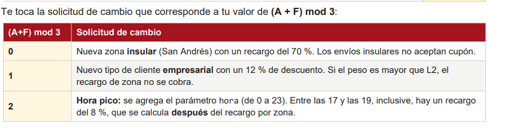

## 8.1 Análisis de impacto

El análisis parte de la matriz de trazabilidad (requisito → historia → casos de prueba): se busca qué requisitos toca el cambio y, siguiendo la matriz, qué historias, casos y partes del código dependen de ellos.

### Requisitos

| Requisito | ¿Afectado? | Cómo |
|------------------------|------------------------|------------------------|
| R1 (peso válido) | No cambia | Se re-ejecuta en la regresión |
| R2 (zona y día válidos) | No cambia | Una zona inválida sigue lanzando error aunque el cliente sea empresarial |
| R3 (tarifa base) | No cambia | Solo se reutiliza la condición peso \> L2 |
| R4 (recargo de zona) | **Modificado** | Excepción: el cliente empresarial con peso \> 10 kg no paga recargo |
| R5 (fin de semana) | No cambia | Se re-ejecuta en la regresión |
| R6 (descuentos) | **Modificado** | Nuevo cliente `empresarial` con 12 %, combinable con el cupón |
| R7 (cupón inexistente) | No cambia | Se re-ejecuta en la regresión |
| R8 (mínimo y redondeo) | No cambia | Se re-ejecuta; CE10 verifica el mínimo con el nuevo cliente |

### Historias de usuario

| Historia | ¿Afectada? | Cómo |
|------------------------|------------------------|------------------------|
| HU-1 (validación) | No | Las validaciones no cambian |
| HU-2 (tarifa por peso, zona y día) | **Modificada** | R4 tiene una excepción |
| HU-3 (descuentos, mínimo y redondeo) | **Modificada** | R6 tiene un cliente nuevo |
| HU-4 (cliente empresarial) | **Nueva** | Cubre el cambio solicitado |

### Casos de prueba

| Casos | Acción |
|------------------------------------|------------------------------------|
| CP12, CP13 (zona) | Se re-ejecutan: cubren R4 |
| CP17 a CP28 (tabla de decisión) | Se re-ejecutan: cubren R6 |
| Los demás casos (CP01 a CP11, CP14 a CP16, CP29) | Se re-ejecutan como regresión |
| CE01 a CE10 | **Nuevos**: cubren el cliente empresarial y la excepción del recargo |
| Partición de cliente (3.1) | Nueva clase válida: `empresarial` |
| Tabla de decisión (3.3) | Se amplía con la fila `empresarial` |

### Código

| Parte del código | Impacto |
|------------------------------------|------------------------------------|
| Constantes (`CLIENTE_EMPRESARIAL`, `DESC_EMPRESARIAL`) | Nuevas |
| Diccionario `CLIENTES` | Una línea nueva con `Descuento(DESC_EMPRESARIAL)` |
| `_cobra_recargo_zona` | Función nueva que decide si se cobra el recargo de zona |
| `calc` | Modificada: aplica el recargo de zona solo si `_cobra_recargo_zona` lo permite |
| `_validar`, `_tarifa_base`, `_redondear` | Sin cambios |
| Clases `Ajuste`, `Recargo`, `Descuento` | Sin cambios: el patrón Estrategia absorbe el cliente nuevo |

### Matriz de trazabilidad actualizada

| Requisito | Historia   | Casos de prueba               |
|-----------|------------|-------------------------------|
| R4        | HU-2, HU-4 | CP12, CP13, CE02 a CE07, CE09 |
| R6        | HU-3, HU-4 | CP17 a CP28, CE01 a CE10      |
| R8        | HU-3       | CP16, CP21 a CP28, CE10       |

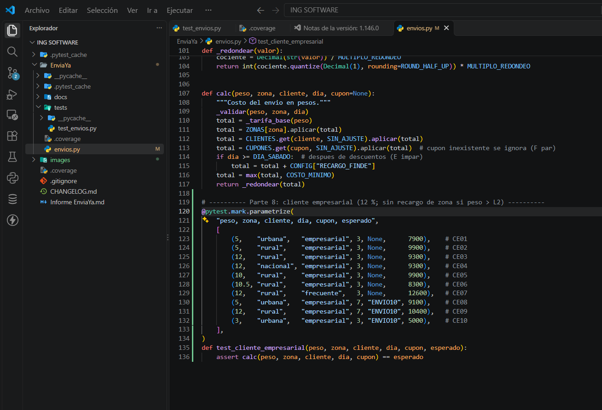

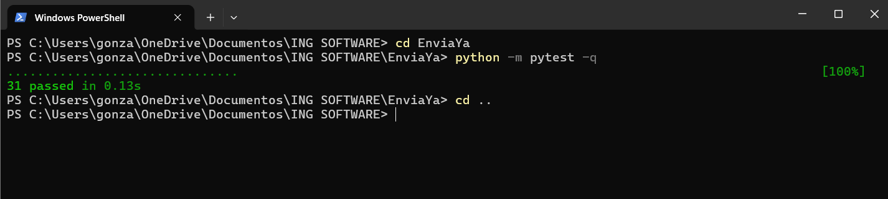

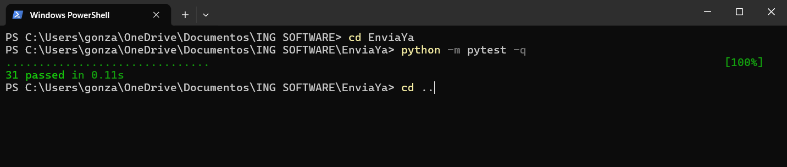
